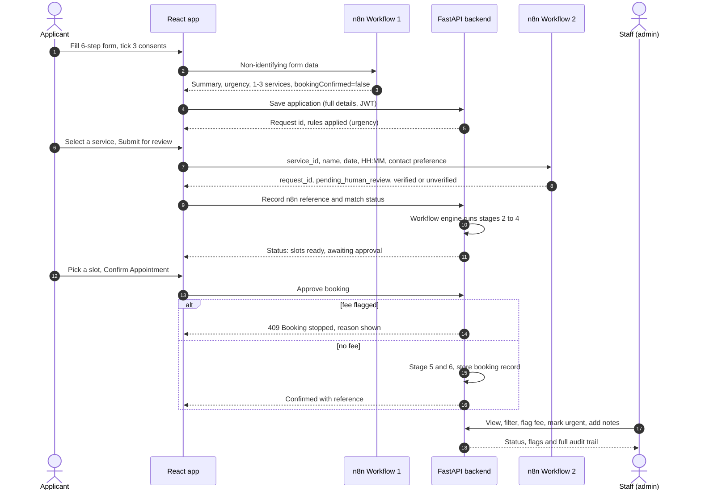

# Legal Aid Navigator — Project Documentation

**ZIRO Agentic AI Hackathon · Domain: Social Impact & Sustainability AI**
**Problem statement: Legal Aid Appointment Navigator**
Last updated: 24 Oct 2026

---

## Contents

1. [Project at a glance](#1-project-at-a-glance)
2. [The problem and who it serves](#2-the-problem-and-who-it-serves)
3. [How the brief maps to what we built](#3-how-the-brief-maps-to-what-we-built)
4. [System architecture](#4-system-architecture)
5. [How it works end to end](#5-how-it-works-end-to-end)
6. [The applicant app](#6-the-applicant-app)
7. [The n8n workflows (the agent layer)](#7-the-n8n-workflows-the-agent-layer)
8. [The backend](#8-the-backend)
9. [The admin portal](#9-the-admin-portal)
10. [Safety and trust model](#10-safety-and-trust-model)
11. [The four official scenarios](#11-the-four-official-scenarios)
12. [Testing and verification](#12-testing-and-verification)
13. [Running the project](#13-running-the-project)
14. [Repository layout](#14-repository-layout)
15. [Known limitations](#15-known-limitations)
16. [Roadmap](#16-roadmap)
17. [Glossary](#17-glossary)

---

## 1. Project at a glance

**Legal Aid Navigator** helps a person who cannot afford a lawyer find free legal aid in their district and request a consultation. It **never gives legal advice**. It finds options, asks a human to approve, and reports honestly on what actually happened.

| | |
|---|---|
| **For** | People seeking free legal assistance; legal aid staff who review requests |
| **Input** | District, legal issue, eligibility details, optional court deadline, appointment preference |
| **Output** | Recommended legal aid services with sources, a request saved for review, a booking status (confirmed, pending, stopped or failed) and an audit trail |
| **Agent layer** | Two n8n workflows using Google Gemini, backed by official directories |
| **Human roles** | The applicant (approves the booking), staff (review, flag, correct) |
| **Core principle** | The system must prove what happened, not merely report what it intended to do |

### What is built

- An **applicant website**: six-step form, recommendations, request submission, live status tracker, and a human approval step before booking.
- An **admin portal**: dashboard, searchable application list, detail pages, staff actions and an audit trail.
- A **FastAPI backend** with accounts, roles, status rules, urgency and fee rules, and an audit log.
- Two **n8n workflows**: one recommends services, one saves requests for human review.
- A **manual test document** (about 70 cases) and a **proof script** for the n8n workflows.

### What is *not* built yet (read this first)

- There is **no mock legal aid portal**. The booking step is simulated inside our backend, so "Confirmed" means the simulation finished, not that an authority confirmed it. See [section 15](#15-known-limitations).
- Fees are flagged by staff or seed data; they are not detected automatically from a portal.
- There is no OTP/CAPTCHA manual step and the app is not yet deployed.

---

## 2. The problem and who it serves

A person who needs legal help but cannot pay for a private lawyer usually does not know:

- whether free legal assistance exists for them,
- which legal services authority covers their district,
- which service fits their issue,
- how to book a consultation, or
- whether the booking is actually confirmed or still pending.

They must work through several websites, read eligibility rules and book on their own, often with no confirmation of the result.

**With Legal Aid Navigator** one interface collects the details, finds suitable services from official sources, shows the proposed request for approval, and tracks the real outcome.

### Users

| User | What they need | What they do in the system |
|---|---|---|
| **Applicant** (primary) | Find free help; understand status | Fills the form, picks a service, approves a slot, tracks progress |
| **Legal aid staff / admin** (secondary) | Organised, complete requests; clear status | Reviews applications, flags fees and urgency, corrects details, adds notes |
| **Operator / evaluator** | Evidence the agent behaves safely | Reads audit trails, runs the test cases and proof script |

### Non-goals

- Giving legal advice or predicting case outcomes.
- Deciding legal eligibility. The system collects evidence and flags it for a person to check.
- Bypassing OTP, CAPTCHA or any access control.

---

## 3. How the brief maps to what we built

| Requirement in the brief | Where it is handled | Status |
|---|---|---|
| Collect district, issue type, eligibility | Six-step form | Done |
| Search trusted sources | n8n Workflow 1 uses official Tamil Nadu SLSA/NALSA directory data | Done (Tamil Nadu focus) |
| Check eligibility and suitability | Workflow 1 gathers evidence; Workflow 2 checks the service against a catalogue; staff decide eligibility | Partial: no automated eligibility decision, by design |
| Propose an action and get human approval | Recommendations page, then **Confirm Appointment** step | Done |
| Execute the booking | Backend booking step | **Simulated** |
| Verify the actual booking record and date | Status computed from the stored booking record; admin card shows reference, date and authority | Done against the simulation |
| Stop on an unexpected fee | Booking refused by the backend; staff flag; admin banner | Done (manual flag) |
| Flag urgency (court deadline in 3 days) | Backend rule on creation; urgent tag and banner | Done |
| Never report a pending booking as "lawyer assigned" | Status rules and wording | Done |
| No legal advice | Notice on the recommendations page; wording throughout | Done |
| Audit trail | `audit_events` table and admin timeline | Done |
| Deployed working app | | **Not done** |
| Presentation | | **Not done** |

---

## 4. System architecture

### 4.1 Component overview

```
                     ┌──────────────────────────────────────────────┐
                     │                  BROWSER                      │
                     │  Applicant app (React)   Admin portal (React) │
                     │       same codebase, separate routes          │
                     └───────────┬───────────────────────┬──────────┘
                                 │ JWT (login)           │ recommendations
                                 │ REST                  │ + review requests
                                 ▼                       ▼ (via dev proxy)
                     ┌──────────────────────┐   ┌──────────────────────────┐
                     │  FastAPI backend      │   │   n8n cloud workflows    │
                     │  :8000                │   │                          │
                     │  • auth + roles       │   │ W1  Recommendation       │
                     │  • requests + stages  │   │     Gemini + official    │
                     │  • status rules       │   │     directory PDF/pages  │
                     │  • admin API          │   │ W2  Request review       │
                     │  • audit log          │   │     validate, catalogue  │
                     └──────────┬───────────┘   │     check, save once     │
                                │               └────────────┬─────────────┘
                                ▼                            ▼
                     ┌──────────────────────┐   ┌──────────────────────────┐
                     │ SQLite (local)        │   │ n8n Data Tables          │
                     │ users, requests,      │   │ legal_aid_services       │
                     │ stages, subtasks,     │   │ legal_aid_requests       │
                     │ audit_events          │   └──────────────────────────┘
                     └──────────────────────┘
```

Two data stores exist on purpose and do not sync automatically:

- **Backend SQLite**: the source of truth for the admin portal and the applicant status page.
- **n8n Data Tables**: the record of what the review workflow saved. The backend keeps the n8n request ID on each application so the two can be matched.

### 4.2 Technology

| Layer | Technology | Why |
|---|---|---|
| Frontend | React 18, Vite, TypeScript, Tailwind CSS, react-router, react-hook-form, lucide-react, react-hot-toast | Fast to build; typed; matches the brief's suggestion |
| Backend | Python, FastAPI, SQLAlchemy 2, Pydantic, python-jose (JWT), passlib + bcrypt | Typed APIs, simple auth, testable rules in code |
| Database | SQLite (local demo). `.env` also supports MySQL/TiDB | Zero setup for a demo |
| Automation and AI | n8n cloud, Google Gemini chat model | Visual workflows the team can show; AI for reading unstructured text |
| Tests | Playwright (headless Chrome) scripts, `verify_n8n.py`, manual test document | Evidence for judges |

### 4.3 Ports and URLs (local)

| Service | URL |
|---|---|
| Frontend | http://localhost:5174 |
| Backend API and docs | http://localhost:8000 and `/docs` |
| n8n Workflow 1 | `https://akalya.app.n8n.cloud/webhook/9ab4524a-1fc4-4509-8445-34210ebeb486` |
| n8n Workflow 2 | `https://akalya.app.n8n.cloud/webhook/legal-aid/request` |

In development, Vite proxies `/api/n8n` and `/api/legal-aid-request` to those webhooks to avoid browser CORS errors. **A production deployment needs an equivalent reverse proxy or CORS configured in n8n.** See [section 16](#16-roadmap).

### 4.4 Design decisions

1. **Rules live in code, not in the AI.** Fee handling, urgency, status mapping and the "cannot mark Confirmed without a record" rule are deterministic and testable. The AI interprets text and recommends; it does not decide safety outcomes.
2. **Recommending, requesting and booking are three separate steps.** Finding a service is not the same as submitting a request, and submitting is not the same as a confirmed booking.
3. **Privacy by omission.** The applicant's name, phone and email are never sent to n8n or the AI. Only non-identifying preferences go out (see [6.3](#63-what-is-sent-where)).
4. **Humans stay in control.** The applicant approves the booking; staff can stop, correct and annotate; every change is logged.
5. **Honest status wording.** "Pending", "unverified" and "no lawyer assigned" are shown as such, never rounded up to success.

---

## 5. How it works end to end

### 5.1 Sequence



### 5.2 The journey in plain steps

| # | Step | Who | What happens | Trust note |
|---|---|---|---|---|
| 1 | Sign in | Applicant | JWT login. Role decides whether they see the form or the admin portal | Admin routes reject applicants (403) |
| 2 | Enter details | Applicant | Location, legal issue, eligibility category, contact, appointment preference | Required fields validated in the browser |
| 3 | Consent | Applicant | Three separate ticks: data use, accuracy, booking authorisation | Submit is blocked until all are ticked |
| 4 | Recommend | Workflow 1 | Gemini summarises the issue, flags missing information and urgency, and suggests up to three services from the official directory | Never books; always requires human approval |
| 5 | Store | Backend | Full application saved. Urgent flag computed from the deadline and urgency | Duplicate saves for the same form are prevented |
| 6 | Select and request | Applicant, Workflow 2 | The chosen service is validated, matched to the catalogue, and saved once for human review | Unknown service is saved but marked **unverified** |
| 7 | Track | Backend | Six stages run; the applicant sees live progress | Each stage has timestamps |
| 8 | Approve | Applicant | Slots appear. The applicant picks one and clicks **Confirm Appointment** | No booking before this click |
| 9 | Book and verify | Backend | If no fee is flagged, the booking record is stored; status derived from the record | A fee refuses the booking, even after approval |
| 10 | Review | Staff | Admin portal shows everything, with flags and a full audit trail | Staff cannot mark Confirmed without a booking record |

### 5.3 The six workflow stages

| Stage | Name | How it advances (simulation) |
|---|---|---|
| 1 | Request Submitted | Immediately on creation |
| 2 | Finding Relevant Services | About 4 s later |
| 3 | Verifying Eligibility | About 6 s later |
| 4 | Fetching Appointment Slots | About 5 s later; generates slot options |
| 5 | Booking Appointment | **Pauses** until the applicant approves a slot |
| 6 | Confirmation | About 3 s after the booking step completes |

Stage 5 status is `awaiting_approval`. The slot picker appears on that stage.

---

## 6. The applicant app

### 6.1 Routes

| Route | Purpose |
|---|---|
| `/login` | Sign in or register |
| `/app/location` → `/app/legal-issue` → `/app/eligibility` → `/app/contact` → `/app/appointment` → `/app/consent` | The six form steps |
| `/agent-response` | Recommendations and request submission |
| `/appointment-status` | Live tracker with the approval step |
| `/app/personal-info` | Review and edit saved details |
| `/admin/*` | Admin portal (administrators only) |

The step bar shows progress. On narrow screens it shows step numbers on a separate row.

### 6.2 Form fields

| Step | Fields |
|---|---|
| Location | Country (defaults to India), state, district (depends on state), city, PIN code |
| Legal issue | Issue type (10 categories), brief description, court case in progress, court deadline, urgency |
| Eligibility | Category, details, supporting document available |
| Contact | Full name, mobile, email, preferred contact method, consultation mode |
| Appointment | Preferred date and time slot, mode, alternative date and slot, notes |
| Consent | Information is accurate; consent to use for legal aid processing; authorise a booking *request* (a human must still approve) |

Form progress is kept in the browser session so refreshing does not lose it.

### 6.3 What is sent where

| Data | Browser | n8n Workflow 1 | n8n Workflow 2 | Backend |
|---|---|---|---|---|
| Location, issue, description, deadline | ✔ | ✔ | — | ✔ |
| Eligibility category and details | ✔ | ✔ | — | ✔ |
| Appointment preference | ✔ | ✔ | date and `HH:MM` only | ✔ |
| **Name, phone, email** | ✔ | **No** | **No** | ✔ |
| Preferred contact method | ✔ | ✔ | ✔ | ✔ |
| Consent flags | ✔ | ✔ | — | ✔ |
| Selected service | ✔ | — | ✔ | ✔ (n8n reference, match status) |

### 6.4 Behaviour worth knowing

- **Errors are readable.** 400, 404, 5xx, timeouts and network failures map to plain messages. Raw HTML or server text is never shown.
- **No false success.** The review step shows success only when Workflow 2 returns `success: true` with a request ID. `bookingConfirmed` is forced to `false` in the browser.
- **No duplicates on retry.** Re-submitting the same form does not create a second application; re-submitting the same service, date and time returns the same n8n request ID.
- **Time format.** The form stores ranges such as `10:00 - 11:00`; Workflow 2 requires `HH:MM`, so the app converts to the start time.
- **Offline demo login** (`test` / `test`) skips the backend, so nothing is stored for staff.

---

## 7. The n8n workflows (the agent layer)

> Node lists below come from the n8n editor as reviewed during development. The workflow internals are maintained by a teammate and may change; the **request and response contracts** below are what the app depends on, and `docs/verify_n8n.py` checks them.

### 7.1 Workflow 1 — Legal Aid Recommendation

**Purpose:** understand the applicant's needs and return up to three relevant, source-backed service options. It recommends; it does not decide eligibility or book.

**Pipeline**

1. **Webhook (POST)** receives the form data.
2. **Edit Fields / If / Merge** nodes validate and normalise input, keeping missing values missing.
3. **Official-source branch:** an HTTP request fetches the official directory document and extracts its text.
4. **AI Agent (Google Gemini)** summarises the issue, finds missing information, assesses urgency and selects services from the official data. It also has an HTTP tool for the Tamil Nadu legal services site.
5. **Respond to Webhook** returns JSON.

**Request (abridged)**

```json
{
  "location": {"state": "Tamil Nadu", "district": "Coimbatore", "pincode": "641001", "city": "Coimbatore", "country": "India"},
  "legalIssue": {"category": "Employment and labour disputes", "description": "…", "urgent": false,
                 "courtCaseInProgress": "no", "courtDeadline": ""},
  "eligibility": {"category": "Low income / financially weaker section", "details": "…", "supportingDocumentAvailable": true},
  "appointment": {"mode": "in_person", "preferredDate": "2026-11-05", "preferredTimeSlot": "10:00 - 11:00"},
  "contact": {"preferredContact": "phone", "consultationMode": "in_person"},
  "consent": {"dataUseAccepted": true, "bookingAuthorization": true, "accuracyAcknowledged": true}
}
```

**Response (abridged)**

```json
{
  "summary": "…",
  "missing_information": [],
  "urgency": "standard",
  "recommended_next_step": "…",
  "status": "pending_review",
  "bookingConfirmed": false,
  "humanApprovalRequired": true,
  "recommended_services": [
    {"service_id": "DLSA-COIMBATORE",
     "service_name": "District Legal Services Authority, Coimbatore",
     "fee_status": "needs_verification",
     "availability_status": "needs_verification",
     "official_source_url": "https://…",
     "verification_status": "official_listed"}
  ],
  "appointment_request": {"service_id": "DLSA-COIMBATORE", "preferredDate": "…", "preferredTimeSlot": "…", "mode": "in_person"}
}
```

`verification_status: "official_listed"` means the service appears in an official directory. It does **not** mean fees, eligibility or availability are verified. The app shows "Listed in official directory" and "Needs verification" accordingly.

The frontend parser accepts both older and newer field spellings (for example `preferred_time` and `preferredTimeSlot`) and rejects responses missing required fields.

### 7.2 Workflow 2 — Legal Aid Request Review

**Purpose:** save the applicant's chosen service as a request a human can review. A recommendation never turns into an application, approval or appointment automatically.

**Pipeline**

1. **Webhook (POST `/legal-aid/request`)** receives only the selected service and appointment preference.
2. **Validate request:** deterministic checks for required fields and allowed formats (for example `HH:MM`), a catalogue lookup on `service_id`, and an AI validation step. The browser is not trusted; the service name alone is never accepted.
3. **Is Request Valid?** Invalid requests go to a validation-error response and are **not** stored.
4. **Save request once:** a duplicate check, then a save to the `legal_aid_requests` data table, then the success response.

**Request**

```json
{"service_id": "DLSA-COIMBATORE", "service_name": "…", "preferred_date": "2026-11-05",
 "preferred_time": "10:00", "contact_preference": "phone"}
```

**Responses**

| Case | HTTP | Key fields |
|---|---|---|
| Saved, service in catalogue | 200 | `success: true`, `request_id`, `status: "pending_human_review"`, `service_match_status: "verified_in_catalogue"`, `humanApprovalRequired: true`, `bookingConfirmed: false` |
| Saved, service unknown | 200 | Same, but `service_match_status: "unverified"` and a message that a human must check |
| Same service, date and time again | 200 | `duplicate: true`, same `request_id` |
| Validation failure | 400 | `success: false`, `validation_errors: [...]` |

### 7.3 What the agents do and do not decide

| The agent / workflow does | The code and humans do |
|---|---|
| Summarise free-text issues | Decide status (rules in the backend) |
| Suggest services from official sources | Verify the service is in the catalogue |
| Flag missing information | Detect and enforce a fee stop |
| Assess urgency from text | Compute urgency from the deadline and flag |
| Return `needs_verification` for fees and availability | Approve the booking (applicant) and review (staff) |

---

## 8. The backend

### 8.1 Data model

| Table | Purpose | Key columns |
|---|---|---|
| `users` | Accounts | `username`, `email`, `hashed_pw`, `role` (`applicant` or `admin`) |
| `legal_aid_requests` | One row per application | Form data; `status`, `current_stage`; `is_urgent`, `urgent_reason`; `fee_detected`, `fee_details`; `admin_status`, `admin_notes`; `n8n_request_id`, `service_id`, `service_name`, `service_match_status`; `booking_reference` |
| `workflow_stages` | Six per request | `stage_number`, `name`, `status`, timestamps, `error`, `result_json` |
| `workflow_subtasks` | Tasks inside each stage | `label`, `description`, `status`, `completed_at` |
| `audit_events` | Append-only history | `request_id`, `actor`, `action`, `detail`, `created_at` |

A small startup migration adds columns introduced after a database was created, so an older database file keeps working.

### 8.2 API

All routes except health, register, login and discovery require a Bearer token.

**Auth** — `/api/v1/auth`

| Method | Path | Notes |
|---|---|---|
| POST | `/register` | Creates an applicant |
| POST | `/login` | Returns a token and the user, including `role` |
| GET | `/me` | Current user |

**Requests (applicant)** — `/api/v1/requests`

| Method | Path | Notes |
|---|---|---|
| POST | `/` | Create an application; computes urgency; starts the workflow thread |
| GET | `/` | The caller's applications |
| GET | `/{id}/status` | Stages, summary, available slots, booking confirmation (own requests only) |
| POST | `/{id}/review` | Records the n8n request ID and service match status |
| POST | `/{id}/book` | Approves a slot. **409** if a fee is flagged; 400 if not awaiting approval or the slot is invalid |

**Admin (role `admin` only)** — `/api/v1/admin`

| Method | Path | Notes |
|---|---|---|
| GET | `/stats` | Total, confirmed, in progress, needs attention, urgent; optional date range |
| GET | `/requests` | Search, status, issue and date filters; pagination |
| GET | `/requests/{id}` | Full detail with stages, flags, notes and audit trail |
| PATCH | `/requests/{id}` | Change status, notes, applicant fields, fee flag, urgent flag |
| GET | `/users`, `/appointments`, `/reports` | Supporting pages |

**Discovery** — `/api/v1/discovery`: authorities (10 reference records), eligibility criteria, issue types, states. This is a **static reference list**, not live data.

### 8.3 Status rules (the heart of honesty)

The displayed status is computed in one place (`app/statuses.py`), in this order:

| Order | Condition | Displayed status |
|---|---|---|
| 1 | Fee flagged | **Stopped – Fee Detected** |
| 2 | Staff set a status | That status |
| 3 | Workflow completed | **Confirmed** |
| 4 | Awaiting the applicant's approval | **Awaiting User Action** |
| 5 | Workflow failed | **Needs Verification** |
| 6 | Service unverified in n8n | **Needs Verification** |
| 7 | Otherwise | **In Progress** |

Other statuses staff can set: **Pending Confirmation** and **Not Eligible**.

**Dashboard tiles** partition applications as: Confirmed, then Needs Attention (Needs Verification, Stopped, or urgent), then Not Eligible (closed), then In Progress.

**Guards**

- Staff cannot set **Confirmed** unless a booking record exists (400 otherwise).
- When a fee is flagged, the status cannot be changed until staff clear the flag (409).
- A fee flag blocks the applicant's **Confirm Appointment** (409), even after approval.
- Applicants can read only their own requests (403 otherwise); admin routes reject non-admins (403).

### 8.4 Urgency rule

A request is urgent if the applicant selected **urgent**, or a **court deadline falls within 0–3 days** of today. The reason is stored (for example "Court deadline in 3 days (2026-10-27)") and an audit event is written.

### 8.5 Audit trail

Events recorded include: `submitted`, `flag_urgent`, `sent_for_human_review`, `booking_approved`, `booking_refused_fee`, `booking_confirmed`, `fee_flagged`, `fee_cleared`, `status_changed`, `urgent_set`, `urgent_cleared`, `applicant_edited` and `note_updated`. Each has an actor, detail and timestamp.

### 8.6 Demo data

On first start the backend creates an admin account and eight synthetic applications covering the four official scenarios plus ordinary cases. They are tagged "Synthetic demo record."

---

## 9. The admin portal

Route `/admin`, accessible only to the `admin` role.

### 9.1 Pages

| Page | What it shows |
|---|---|
| **Applications** | Four tiles (Total, Confirmed, In Progress, Needs Attention); search by name, ID, phone or email; status, issue and date filters; paginated table with an **Urgent** tag; View button |
| **Application Details** | Header with status; banners for urgent, fee stopped and unverified service; summary row; six-step progress with a detail panel for each step; honest booking outcome card; audit trail; side panels for applicant, request, appointment, staff actions and notes |
| **Users** | Accounts, roles and application counts |
| **Appointments** | Requested dates and times with status. Only Confirmed rows are confirmed appointments |
| **Authorities** | The reference directory |
| **Reports** | Counts by status, issue and district; urgent, fee-stopped and unverified totals |
| **Settings** | Signed-in user and backend reachability |

### 9.2 Staff actions

| Action | Effect |
|---|---|
| Set status | Overrides the computed status; logged. Blocked for Confirmed without a record, and while a fee is flagged |
| Flag unexpected fee and stop booking | Status becomes Stopped; applicant booking refused; logged |
| Clear fee flag | Restores the normal status; logged |
| Mark or remove urgent | Toggles the flag and banner; logged |
| Edit applicant name, phone, email | Saves and logs the field changed |
| Notes | Saved per application; logged |

### 9.3 Booking outcome card (what it will and won't say)

| Situation | Card |
|---|---|
| Confirmed with a record | Green: appointment ID, date and time, mode, authority |
| Pending Confirmation | Orange: "Booking pending — not confirmed … No lawyer has been assigned." |
| Fee flagged | Red: "Booking stopped" |
| Anything else | Neutral: "No confirmed appointment … No lawyer has been assigned." |

### 9.4 Design notes

Same olive and ivory palette as the applicant app. Status colours: Confirmed green, In Progress amber, Awaiting User Action blue, Pending orange, Needs Verification red, Stopped dark red, Not Eligible grey. Loading and error states include a **Retry**. Tables scroll inside their container on phones, and the stepper scrolls inside its card, so the page itself never scrolls sideways.

---

## 10. Safety and trust model

| Rule | Where it is enforced | How to see it |
|---|---|---|
| No legal advice | Notice on the recommendations page; no advice content in any flow | Recommendations page |
| No booking without applicant approval | Booking only starts from the approve endpoint | TC1 steps 5–6 |
| A fee stops the booking, even after approval | Backend returns 409; staff must clear the flag | TC2 |
| Pending or unverified is never shown as confirmed | `statuses.py`; outcome card wording | TC4 |
| Staff cannot fabricate a confirmation | PATCH rejects Confirmed without a record | TC4 step 3 |
| The browser is not trusted | Workflow 2 validates the service ID against a catalogue | `verify_n8n.py` |
| Only the right people see data | JWT, per-user ownership checks, admin role guard | Test cases AUTH-04, AUTH-06 |
| Personal identifiers stay out of the AI | Payload builder omits name, phone, email | Section 6.3 |
| Every change is traceable | Append-only audit events | Admin detail page |
| No bypassing OTP or CAPTCHA | None attempted. A safe manual step is **not yet built** | Section 15 |
| No retry creates a duplicate | Backend form check; Workflow 2 duplicate check | APP-10, N8N-05 |

---

## 11. The four official scenarios

| | Scenario | How this project handles it | How to demonstrate |
|---|---|---|---|
| **TC1** | Eligible person in district | Form, recommendation, review request, human approval, booking, confirmation record | Run the form with the TC1 values; approve a slot; show Confirmed in admin |
| **TC2** | Unexpected fee appears | Fee flag stops the booking, with a reason shown and an audit entry | Open the seeded Rahul Kumar record; or flag a fee and try to confirm as the applicant |
| **TC3** | Court deadline in 3 days | Deadline within 3 days sets the urgent flag, banner and audit event | Submit with a deadline three days out; open the seeded Meera Patel record |
| **TC4** | Booking still pending | Status stays Pending; staff cannot mark Confirmed; wording says no lawyer assigned | Open the seeded Suresh Reddy record and try to confirm it |

**Honest caveat:** in TC1 the "booking" is produced by our simulation; in TC2 the fee is flagged by staff. Both become fully real once a mock portal returns those states. See [section 16](#16-roadmap).

---

## 12. Testing and verification

| Asset | Location | What it covers |
|---|---|---|
| Demo recording plan | `docs/DEMO_RECORDING_GUIDE.md` | Scene-by-scene script, timings from a rehearsal, judge Q&A, failure fallbacks |
| Manual test cases | `docs/MANUAL_TEST_CASES.md` | About 70 cases: TC1–TC4, sign-in and access, the applicant journey, the admin portal, n8n, responsive layout, safety statements |
| n8n proof script | `docs/verify_n8n.py` | 12 live checks of both workflows; prints timestamps and request IDs; exit code 0 when all pass |
| Browser regression | Playwright scripts (kept outside the repo) | Admin portal journey, applicant journey, TC1 and TC2 in a real browser |
| Static checks | `npx tsc -b`, `npm run build` | Type safety and a production build |

**Latest results**

- `verify_n8n.py`: **12 of 12 passed**.
- Admin portal browser run: login and role guard, filters, pagination, empty state, TC1–TC4 pages, notes and all sidebar pages passed.
- Applicant browser run: country default, consent block, recommendations, review submission and duplicate handling passed.
- TC2 in the browser: the booking was refused with a reason and logged. TC1: approval led to Confirmed with a reference.
- Not yet verified: audit entries for approval and confirmation in the admin UI after the final changes, and the full applicant journey rerun after the last patches.

**How to prove the n8n workflows are live**

1. Run `python docs/verify_n8n.py` and keep the output.
2. In n8n open each workflow, then **Executions**, and match the green runs to the timestamps.
3. Open the `legal_aid_requests` data table and find the request ID.
4. Show the same request ID in the app and in the admin portal.

---

## 13. Running the project

### 13.1 Prerequisites

- Python 3.10+ and Node 18+.
- Backend packages: `pip install -r backend/requirements.txt` (includes `bcrypt==4.0.1`, needed for registration to work with the pinned `passlib`).
- Frontend packages: `npm install` in `frontend/`.

### 13.2 Start

```bash
# Backend (local SQLite)
cd backend
DATABASE_URL=sqlite:///./legal_aid.db python -m uvicorn app.main:app --port 8000

# Frontend
cd frontend
npm run dev -- --port 5174
```

On Windows PowerShell set the variable first: `$env:DATABASE_URL="sqlite:///./legal_aid.db"`.

### 13.3 Accounts

| Role | Username | Password |
|---|---|---|
| Admin | `admin` | `Admin@12345` |
| Applicant | `demo_user` | `Demo@12345` |
| Offline demo | `test` | `test` |

These are demo credentials. Change them before any real use.

### 13.4 Configuration

| Setting | Where | Notes |
|---|---|---|
| `DATABASE_URL` | `backend/.env` or environment | The checked-in `.env` points at a remote TiDB database; override with SQLite for local use |
| `JWT_SECRET` | `backend/.env` | Defaults to a placeholder; **must** be changed for any shared deployment |
| `ALLOWED_ORIGINS` | `backend/app/core/config.py` | Defaults to localhost ports 5173–5175 |
| `VITE_API_URL` | `frontend/.env` | Backend address; defaults to `http://localhost:8000` |
| n8n webhook paths | `frontend/vite.config.ts` | Dev proxy targets |

### 13.5 Environment notes

- `backend/venv` was copied from another machine and does not work. Create a new virtual environment.
- The database driver `pymysql` is not installed, so the default `.env` database fails until it is installed or `DATABASE_URL` is overridden.

---

## 14. Repository layout

```
Legal Aid Navigator/
├─ backend/
│  ├─ app/
│  │  ├─ main.py            app, routers, startup seeding
│  │  ├─ models.py          SQLAlchemy tables
│  │  ├─ schemas.py         request and response models
│  │  ├─ database.py        engine, session, column migration
│  │  ├─ statuses.py        status and urgency rules
│  │  ├─ audit.py           audit helper
│  │  ├─ workflow.py        six-stage workflow engine (simulation)
│  │  ├─ seed.py            admin account and demo applications
│  │  └─ routers/           auth, requests, admin, discovery
│  ├─ requirements.txt
│  └─ test_api.py
├─ frontend/
│  └─ src/
│     ├─ pages/             applicant pages
│     │  └─ admin/          admin pages
│     ├─ components/        common, navigation, admin
│     ├─ contexts/          auth and form state
│     ├─ services/          api.ts, adminApi.ts
│     ├─ utils/             n8nPayload.ts, n8nResponse.ts
│     └─ data/              state and district lists
└─ docs/
   ├─ PROJECT_DOCUMENTATION.md   this file
   ├─ MANUAL_TEST_CASES.md
   ├─ DEMO_RECORDING_GUIDE.md    shot-by-shot plan for the submission video
   ├─ start_demo.ps1             one-command clean demo environment
   └─ verify_n8n.py
```

---

## 15. Known limitations

| # | Limitation | Impact | Planned fix |
|---|---|---|---|
| 1 | **No mock legal aid portal.** The booking step is a backend simulation with fixed delays and generated slots | "Confirmed" is not an authority's confirmation; slots and dates are generated (the authority is named after the applicant's district) | Build the mock portal and make the booking and verification steps call it |
| 2 | Fees are not detected automatically | TC2 depends on a staff flag or seed data | The mock portal reports fees; the booking step stops on them |
| 3 | No OTP or CAPTCHA manual step | A brief requirement is not demonstrated | Add a human step in the mock portal flow |
| 4 | Not deployed | The brief requires a deployed app | Deploy backend and frontend; add a reverse proxy for n8n |
| 5 | Two data stores do not sync | A request saved only in n8n does not appear in the admin portal | Sync from n8n, or write n8n results to the backend |
| 6 | Reference authority list is static (10 records) | Not live data | Pull from official directories |
| 7 | Coverage focuses on Tamil Nadu | Other states return limited results | Add other states' official sources |
| 8 | Eligibility is flagged, not decided | By design; but no structured eligibility check exists | Rules per authority, reviewed by staff |
| 9 | Demo-grade security | Default JWT secret, demo credentials, a credential in `.env`, an offline login that skips the backend | Rotate secrets, remove demo shortcuts, use environment variables |
| 10 | Fee, availability and eligibility values from Workflow 1 are "needs verification" | The applicant sees unverified details | Verify against the authority |
| 11 | Workflow internals may drift | The app depends only on the contracts in section 7 | Re-run `verify_n8n.py` after any change |
| 12 | Test data in the n8n table | Several test rows exist | Delete before the demo |

---

## 16. Roadmap

**Next (closes most gaps)**

1. **Mock legal aid portal** with real states: available slots, **pending**, **confirmed** and **unexpected fee**. Replace the simulated booking with calls to it, and verify the result by reading the portal's record back.
2. **Deploy** the backend and frontend, with a reverse proxy for the n8n webhooks (the Vite proxy works only in development).
3. **Presentation:** problem, architecture, a live demo of TC1–TC4, the human's role and the limitations.

**Then**

4. Automatic fee detection and a manual OTP/CAPTCHA step in the portal flow.
5. Sync n8n results into the backend so the admin sees every request.
6. Nearest-office matching using geocoding, with officer availability shown only if an official source exposes it.
7. More states and live directory sources.
8. Notifications to applicants and staff.

---

## 17. Glossary

| Term | Meaning |
|---|---|
| **DLSA** | District Legal Services Authority — the district body that provides free legal aid |
| **SLSA** | State Legal Services Authority |
| **NALSA** | National Legal Services Authority |
| **Agentic** | A system that plans steps, uses tools, takes permitted actions and checks results, rather than only answering |
| **Human in the loop** | A person must approve the action before it happens |
| **Pending** | Received but not confirmed. Never shown as a confirmed booking |
| **Unverified** | Not found in the catalogue or an official source. Needs a person to check |
| **Needs verification** | A detail (fee, availability, eligibility) the system has not confirmed |
| **Audit trail** | The ordered, append-only record of what happened, who did it and when |
| **Webhook** | A URL that starts an n8n workflow when called |
| **JWT** | The signed token the app sends to prove who is logged in |
